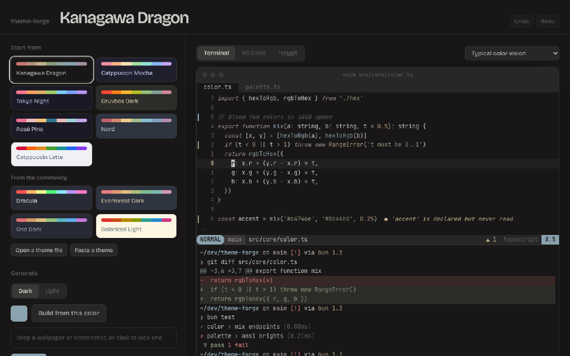
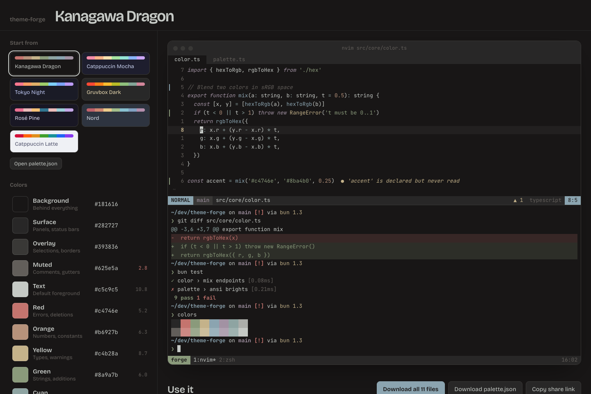

# theme-forge

Pick twelve colors once. Get matching themes for your terminal, editor, and
command-line tools.

**[Try it in your browser](https://nakulpatel0306.github.io/theme-forge/)** · **[Read the guide](docs/GUIDE.md)**



Making every tool match by hand means editing a dozen config files, each in a
different format. theme-forge gives you one palette, a live preview of a real
looking tmux + Neovim + shell session, and an export for each tool.

## Supported tools

| Kind      | Tools                                                |
| --------- | ---------------------------------------------------- |
| Terminals | Ghostty, Kitty, Alacritty, WezTerm, iTerm2, Warp     |
| Editors   | Neovim, VS Code, Cursor, Zed, Helix                  |
| CLI tools | bat, delta, tmux, Starship, lazygit, fzf, btop, fish |

Every export is a standalone theme file. theme-forge never edits your main
config, so switching a theme on is always a single line you add yourself.
VS Code and Cursor get a real extension (`.vsix`); `apply` installs it into
whichever of the two you have.

## Use the web app

```sh
bun install
bun dev
```



Start from a preset or a community theme, or bring your current one: **Open a
theme file** or **Paste a theme** reads Ghostty, Kitty, Alacritty, WezTerm,
iTerm2 and Xresources themes, and `palette.json`. You can also **Generate** a
palette from one color or from a wallpaper you drop in, or press **Space** to
shuffle. Lock the colors you like first and generators leave them alone.

Click a swatch or type a hex value and the whole app repaints as you go. The
number next to each color is its contrast against the background; below 3:1
(4.5:1 for text) it turns into a **Fix** button that lightens or darkens the
color just enough, keeping its hue. **Syntax** picks which color keywords,
strings, functions and the rest get, and whether comments and keywords are
italic. The preview switches between a **Terminal** (tmux, Neovim, shell), a
**VS Code** window and **lazygit**, and can simulate red-, green- and
blue-blind vision so you can check your diff colors still read.

When it looks right, **Use it** shows the file for each tool, where it goes,
and the line that turns it on. Download one, or all of them as a zip. Rename
the theme by editing the big title; **Undo** and **Redo** (⌘Z, ⇧⌘Z) cover
every change. The URL always holds the current palette, so copying it shares
your theme.

## Live sync

```sh
bun cli/index.ts live
```

This opens the editor in your browser and keeps your real tools in step with
it. Drag a color and, within a moment:

- every running **Neovim** switches to the live theme (no setup)
- your **tmux** status bar and borders recolor (no setup)
- **Ghostty** reloads, once you've added `theme = theme-forge-live` to its config

Press Ctrl+C and Neovim and tmux go back to exactly what they were. The live
server only listens on `127.0.0.1` and refuses connections from any page other
than the editor itself.

## Use the CLI

```sh
bun cli/index.ts list                              # presets and tools
bun cli/index.ts preview kanagawa-dragon           # print the palette
bun cli/index.ts export my-theme.json --out ./out  # write every file to a folder
bun cli/index.ts apply my-theme.json               # show what would be installed
bun cli/index.ts apply my-theme.json --yes         # install into ~/.config
bun cli/index.ts export ~/.config/kitty/theme.conf --only ghostty  # convert Kitty -> Ghostty
```

Anywhere a theme goes, you can pass a preset name, a community theme name, a
`palette.json`, or any terminal theme file theme-forge can import.

`bun run cli <command>` works too, e.g. `bun run cli list`.

`apply` is a dry run unless you pass `--yes`. If a theme file already exists
and its contents changed, the old one is kept next to it as `<name>.bak-<time>`.
Limit any command to some tools with `--only ghostty,neovim,tmux`.

## How the palette works

| Slot       | Used for                         |
| ---------- | -------------------------------- |
| Background | Behind everything                |
| Surface    | Status bars, tab bars, panels    |
| Overlay    | Selections, borders              |
| Muted      | Comments, line numbers           |
| Text       | Default foreground               |
| Red        | Errors, deletions                |
| Orange     | Numbers, constants               |
| Yellow     | Types, warnings                  |
| Green      | Strings, additions               |
| Cyan       | Operators, info                  |
| Blue       | Functions, links, focus          |
| Magenta    | Keywords                         |

The remaining colors a tool needs, like bright ANSI variants, diff
backgrounds, and the cursor line, are derived from these twelve in
[`src/core/palette.ts`](src/core/palette.ts). Which syntax token gets which
color lives in one map, [`src/core/syntax.ts`](src/core/syntax.ts), shared by
the preview and the editor exports, so the preview shows what you'll get.

## Share a theme

Drop a `palette.json` (from **Download palette.json**) into [`themes/`](themes),
named after the theme (`themes/my-theme.json`), add an `"author"` field, and
open a pull request. It shows up under **From the community** in the app and
by name in the CLI. CI checks that it loads and that its text is readable.

## Add a tool

Each tool is one small file in [`src/targets`](src/targets). See
[CONTRIBUTING.md](CONTRIBUTING.md); a new target is usually about 30 lines.

## Development

```sh
bun test         # unit tests, snapshot tests for every target, CLI tests
bun run build    # typecheck and production build
bun run lint
```

## License

[MIT](LICENSE)
