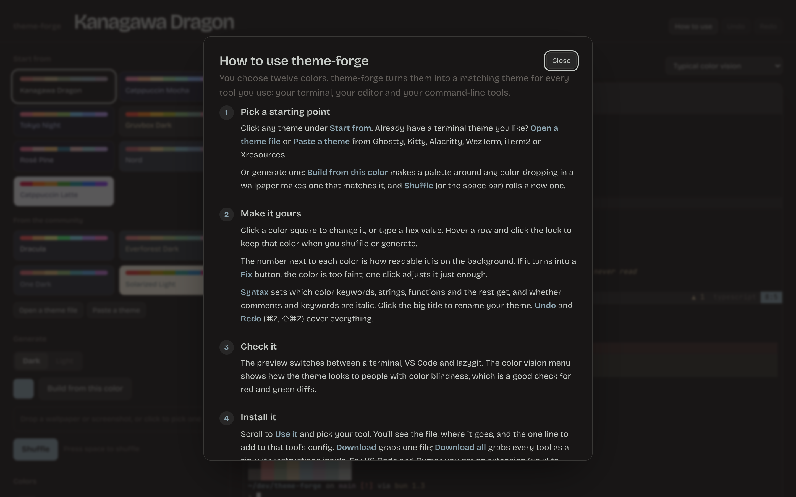

# theme-forge guide

theme-forge turns twelve colors into a matching theme for every tool you use.
This guide walks through the web app, installing themes, the command-line tool
and live sync. For a two-minute overview, see the [README](../README.md).

- [The idea](#the-idea)
- [Using the web app](#using-the-web-app)
- [Installing a theme](#installing-a-theme)
- [The command-line tool](#the-command-line-tool)
- [Live sync](#live-sync)
- [Per-tool setup](#per-tool-setup)
- [Troubleshooting](#troubleshooting)

## The idea

Every tool stores colors in its own file and format, so making them match
means editing each one by hand. theme-forge keeps one palette of twelve colors
and writes the right file for each tool from it:

| Color      | Used for                         |
| ---------- | -------------------------------- |
| Background | Behind everything                |
| Surface    | Status bars, tab bars, panels    |
| Overlay    | Selections, borders              |
| Muted      | Comments, line numbers           |
| Text       | Default foreground               |
| Red        | Errors, deletions                |
| Orange     | Numbers, constants               |
| Yellow     | Types, warnings                  |
| Green      | Strings, additions               |
| Cyan       | Operators, info                  |
| Blue       | Functions, links, focus          |
| Magenta    | Keywords                         |

Anything else a tool needs, like the bright terminal colors or diff
backgrounds, is worked out from these.

## Using the web app

Open the [hosted app](https://nakulpatel0306.github.io/theme-forge/), or run it
yourself with `bun install && bun dev` and open http://localhost:5179. The
**How to use** button in the app has a short version of this section.



### 1. Pick a starting point

- **Start from** a built-in theme or one **from the community**.
- **Open a theme file** or **Paste a theme** to bring in what you use today.
  theme-forge reads Ghostty, Kitty, Alacritty, WezTerm, iTerm2 and Xresources
  themes, and its own `palette.json`. Terminal themes don't define orange, so
  theme-forge places one between your red and yellow.
- **Generate** one:
  - **Build from this color** makes a full palette around one color you pick.
  - **Drop a wallpaper or screenshot** to get a palette that feels like it.
  - **Shuffle** (or press the space bar) rolls a random palette.
  - **Dark** / **Light** chooses which kind the generators make.

### 2. Make it yours

- Click a color square for a color picker, or type a hex value next to it.
- Hover a row and click the **lock** to keep that color through shuffles and
  generators.
- The number at the end of each row is the color's contrast against the
  background. Text needs 4.5 and everything else 3. Below that it becomes a
  **Fix** button, which makes the color lighter or darker just enough to pass
  without changing its hue.
- **Syntax** decides which color each kind of code gets and whether comments
  and keywords are italic.
- Click the big title to rename the theme. File names follow the name.
- **Undo** / **Redo** (⌘Z / ⇧⌘Z, or Ctrl on Windows and Linux) cover every
  change.

### 3. Check it

- The preview tabs show your theme in a **Terminal** (tmux with Neovim and a
  shell), **VS Code** and **lazygit**.
- The color vision menu simulates red-, green- and blue-blindness. Check that
  your diff colors (red and green) still read as different.

### 4. Save or share it

- Your palette is saved in the browser and kept in the page address.
- **Copy share link** copies that address; anyone who opens it sees your theme.
- **Download palette.json** saves the palette itself, for the CLI or to
  [share it with everyone](../CONTRIBUTING.md#sharing-a-theme).

## Installing a theme

In the **Use it** section, pick your tool. It shows three things:

1. **Where the file goes**, like `~/.config/ghostty/themes/my-theme`.
2. **The line that switches it on**, like `theme = my-theme` in your Ghostty
   config.
3. **The file itself**, to copy or download.

**Download all** gets every tool's file in one zip, with a `README.txt` listing
where each one goes. The folders in the zip mirror `~/.config/`.

theme-forge never edits your existing config files. Each tool gets a separate
theme file, and you add the one line yourself, so nothing you've set up is
overwritten.

## The command-line tool

The CLI does the copying for you. You need [Bun](https://bun.sh) and a clone
of the repo:

```sh
git clone https://github.com/nakulpatel0306/theme-forge
cd theme-forge
bun install
```

Every command takes a theme, which can be:

- a built-in or community theme name: `kanagawa-dragon`, `"Rosé Pine"`, `dracula`
- a `palette.json` downloaded from the app
- any terminal theme file theme-forge can import, like a Kitty `.conf`

### Commands

```sh
bun cli/index.ts list                       # every theme and tool
bun cli/index.ts preview dracula            # print a theme's colors
bun cli/index.ts export dracula --out ./out # write every file to a folder
bun cli/index.ts apply dracula              # show what would be installed
bun cli/index.ts apply dracula --yes        # install it
bun cli/index.ts live                       # live sync, see below
```

| Option          | Does                                                    |
| --------------- | ------------------------------------------------------- |
| `--only a,b`    | Limit to some tools, e.g. `--only ghostty,neovim,tmux`  |
| `--out <dir>`   | Where `export` writes (default `./<theme-name>`)        |
| `--yes`         | Lets `apply` write; without it, it only shows the plan  |
| `--home <dir>`  | Install somewhere other than your home folder           |

`apply` details:

- It writes the same files the app shows, at the same paths.
- If a file is already there with different contents, the old one is kept as
  `<name>.bak-<date>`.
- If VS Code or Cursor is installed, it installs the theme extension in them.
- At the end it prints the line to add for each tool.

### Converting between terminals

Because any terminal theme can be read in, the CLI also converts themes:

```sh
bun cli/index.ts export ~/.config/kitty/current-theme.conf --only ghostty,wezterm
```

## Live sync

```sh
bun cli/index.ts live
```

This opens the app in your browser, connected to your computer. As you edit:

- Every running **Neovim** switches to the theme you're editing. No setup.
- **tmux** recolors its status bar and borders. No setup.
- **Ghostty** reloads, once you've added `theme = theme-forge-live` to its
  config.

Press **Ctrl+C** to stop. Neovim and tmux go back to exactly what they had
before. The `theme-forge-live` files stay in place in case you want to keep
them.

The live server only listens on your own machine and only accepts the app
itself, so other websites can't send it colors.

## Per-tool setup

`apply` and the app both tell you the switch-on line for each tool. For
reference:

| Tool | File | Turn it on |
| ---- | ---- | ---------- |
| Ghostty | `~/.config/ghostty/themes/<name>` | `theme = <name>` in `~/.config/ghostty/config` |
| Kitty | `~/.config/kitty/themes/<name>.conf` | `include themes/<name>.conf` in `kitty.conf` |
| Alacritty | `~/.config/alacritty/themes/<name>.toml` | `import = ["~/.config/alacritty/themes/<name>.toml"]` under `[general]` |
| WezTerm | `~/.config/wezterm/colors/<name>.toml` | `config.color_scheme = '<name>'` |
| iTerm2 | `~/.config/theme-forge/<name>.itermcolors` | Double-click it, then pick it in Profiles > Colors |
| Warp | `~/.warp/themes/<name>.yaml` | Pick it in Settings > Appearance > Themes |
| Neovim | `~/.config/nvim/colors/<name>.lua` | `:colorscheme <name>` |
| VS Code / Cursor | `~/.config/theme-forge/<name>.vsix` | `code --install-extension <file>`, then choose it under Color Theme |
| Zed | `~/.config/zed/themes/<name>.json` | Restart Zed, then `theme selector: toggle` |
| Helix | `~/.config/helix/themes/<name>.toml` | `theme = "<name>"` in `config.toml` |
| bat | `~/.config/bat/themes/<name>.tmTheme` | `bat cache --build`, then `--theme="<name>"` |
| delta | `~/.config/delta/themes/<name>.gitconfig` | Include it in `~/.gitconfig` and set `features = <name>` |
| tmux | `~/.config/tmux/themes/<name>.conf` | `source-file` it from `tmux.conf` |
| Starship | `~/.config/starship/palettes/<name>.toml` | Paste it into `starship.toml` |
| lazygit | `~/.config/lazygit/themes/<name>.yml` | Add it to `LG_CONFIG_FILE` |
| fzf | `~/.config/fzf/themes/<name>.sh` | `source` it from `~/.zshrc` |
| btop | `~/.config/btop/themes/<name>.theme` | `color_theme = "<name>"` in `btop.conf` |

`<name>` is your theme's name in lowercase with dashes: `Quiet Harbor` becomes
`quiet-harbor`.

## Troubleshooting

**A color looks different in my terminal than in the preview.** Some
terminals draw bold text with the bright colors, or apply their own minimum
contrast. Check those settings in your terminal.

**bat or delta still show the old colors.** bat only sees new themes after
`bat cache --build`. delta uses bat's themes, so build the cache first.

**VS Code didn't pick up a change.** Reinstall the `.vsix` (`apply` does this
for you), then choose the theme again under Preferences: Color Theme.

**Live sync says it's waiting for an editor.** It looks for running Neovim
instances each time a color changes, so open Neovim and then change any color.
Neovim 0.9 and newer listen by default; if `:echo v:servername` prints nothing,
yours isn't listening.

**An imported theme's orange looks off.** Terminal themes don't define orange,
so theme-forge estimates it. Set it by hand in the Colors list.
